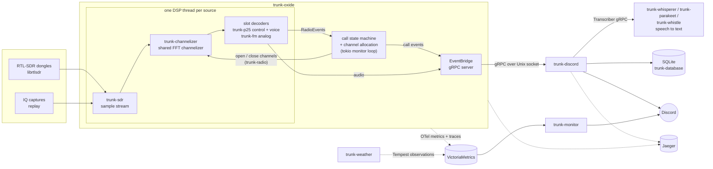

# trunk-oxide

[](https://github.com/NathanHowell/trunk-oxide/actions/workflows/ci.yml)

A Rust SDR scanner for P25 trunked and conventional analog radio systems. It opens RTL-SDR dongles with librtlsdr, channelizes each one with a shared FFT channelizer, decodes P25 control and voice channels (trunk-p25) and analog FM (trunk-fm), runs the call state machine, and publishes calls and audio over gRPC. It began as a Rust driver for [trunk-recorder](https://github.com/robotastic/trunk-recorder); the C++/GNU Radio stack has since been replaced entirely.

Recorded calls are streamed over gRPC to companion services for transcription and Discord integration.

## Services

**trunk-oxide** -- The core scanner. Reads TOML config, calibrates and opens the SDR sources, builds the radio (trunk-radio) and exposes a gRPC event stream for call data and audio.

**trunk-discord** -- Discord bot that subscribes to trunk-oxide events. Posts call recordings with metadata (talkgroup, unit IDs, duration) as embeds in organized Discord channels, with optional transcriptions.

**trunk-whisperer** / **trunk-parakeet** / **trunk-whistle** -- Interchangeable speech-to-text backends serving the same `Transcriber` gRPC service: [whisper.cpp](https://github.com/ggerganov/whisper.cpp) (optional CUDA), NVIDIA Parakeet via ONNX Runtime, and the CPU-only Cactus Whistle model. Pick one at the container level.

**trunk-monitor** -- Keeps a metrics dashboard (a chart drawn from VictoriaMetrics) up to date in a Discord channel.

**trunk-weather** -- Streams a Tempest weather station's observations into VictoriaMetrics, to line up with decode quality. Optional.

**trunk-solver** -- Plans which dongle runs which center frequency and sample rate so every configured channel is covered, using as few dongles as possible.

**trunk-uls** -- Reads the FCC's land-mobile licence data for the sites licensed around the receiver, compares them with what the config scans, and turns an `rtl_power` sweep into channel occupancy.

## Configuration

All services are configured with TOML files. Talkgroup and channel databases can be defined inline or loaded from CSV files (compatible with [RadioReference](https://www.radioreference.com/) exports), with TOML entries acting as overlays to selectively override CSV fields.

Copy the examples and edit them for your system; the live files are gitignored:

| Example | Copy to | Used by |
|---|---|---|
| `config.toml.example` | `config.toml` | trunk-oxide |
| `talkgroups.csv.example`, `conventional-channels.csv.example` | named by `talkgroup_file` / `channel_file` | trunk-oxide |
| `config-discord.toml.example` | `config-discord.toml` | trunk-discord |
| `config-monitor.toml.example` | `config-monitor.toml` | trunk-monitor |

`config-whisperer.toml`, `config-parakeet.toml` and `config-whistle.toml` are generic and checked in.

A `config.toml` for trunk-oxide:

```toml
[recorder]
temp_dir = "/dev/shm"
call_timeout = 3.0
max_channels = 8       # channels open at once, across every source (see below)

[[source]]
driver = "rtlsdr"      # an RTL-SDR, opened with librtlsdr ("iqfile" replays a capture)
device = "rtl=00000001" # the dongle's USB serial
center = 771496500.0
rate = 2496000.0
gain = 40.0

[system.smco]
type = "p25"
control_channels = [772031250.0, 772406250.0]
modulation = "qpsk"
talkgroup_file = "talkgroups.csv"
# control_channel_priority = 0   # the control channels' claim (default 0)
# emergency_priority = 0         # an emergency's claim, if better than its talkgroup's
# default_priority = 4           # talkgroups without one (default: after every listed one)

[system.conv]
type = "conventional"
squelch = -50.0
channel_file = "conventional-channels.csv"

[grpc]
listen_path = "/run/service/grpc.sock"
```

Supported system types: `p25`, `conventional`, `conventionalP25` (Smartnet and DMR are not ported yet).

### Channels and priority

Every control channel, trunked call and conventional channel holds one channel while it is open, and there are `max_channels` of them, shared by all sources (`trunk-solver` sizes it). Each claims a channel at a priority, lower numbers first: a talkgroup's from its CSV `Priority` column or TOML overlay, a conventional channel's from its `priority`, a control channel's from `control_channel_priority`. `-1` never records. When every channel is held, a call that outranks a holder evicts it (the holder's call ends as evicted, and Discord marks it); an equal or lower claim waits for one to free, and is admitted when one does. A holder keeps its channel against an equal newcomer.

## Deployment

The system is designed to run as a set of Docker containers communicating over gRPC via Unix domain sockets:

```
docker compose --profile whisper up --build
```

This starts:
- **trunk-oxide** -- scanner with access to USB SDR devices
- **a transcriber**, when a profile picks one: `--profile whisper`, `--profile parakeet` or `--profile whistle` (a one-shot container downloads the model on first run)
- **trunk-discord** -- Discord bot (requires a token in `secrets/discord_token`)
- **trunk-monitor** -- the Discord metrics dashboard
- **trunk-weather** -- Tempest weather metrics (requires a token in `secrets/tempest_token`)
- **Jaeger** -- distributed tracing UI at `http://localhost:16686`
- **VictoriaMetrics** -- metrics store for the OpenTelemetry metrics, queried by trunk-monitor

`docker-compose.yml` bind-mounts `config.toml`, the talkgroup/channel CSVs and the service configs from the checkout; edit the CSV mounts to match the files your `config.toml` names.

Services use health checks to enforce startup ordering and report readiness.

### Environment Variables

| Variable | Description |
|---|---|
| `OTEL_EXPORTER_OTLP_ENDPOINT` | OpenTelemetry collector endpoint (enables tracing and metrics) |
| `RUST_LOG` | Log level filter (e.g. `info`, `debug`, `trunk_oxide=debug`) |

## Building from Source

Requires Rust 1.100+ (edition 2024).

```bash
cargo build -p trunk-oxide
```

Building trunk-oxide natively needs librtlsdr (`librtlsdr-dev`, or just the
runtime `librtlsdr0`: the build links `librtlsdr.so.0` directly when the
development package is absent) and protobuf (`protobuf-compiler`,
`libprotobuf-dev`). Everything else is Rust.

## Architecture



Each source runs its own DSP thread: it reads its stream, runs the shared
channelizer and every decoder on its slots, sends radio events to the call
state machine and audio straight to the EventBridge. The state machine runs on
a tokio monitor loop, decides which calls hold one of the `max_channels`
channels, and opens and closes them on the radio. See
[docs/architecture.md](docs/architecture.md) for the details.

## License

trunk-oxide is licensed under the GNU General Public License v3.0 or later; see [LICENSE](LICENSE).

Parts of it are ports of GPL code, and keep its terms:

- The P25 decoders and IMBE/AMBE vocoders follow [op25](https://github.com/boatbod/op25) (GPL-3.0-or-later).
- The Motorola alias algorithm and the call handling it grew from follow [trunk-recorder](https://github.com/robotastic/trunk-recorder) (GPL-3.0).
- [librtlsdr](https://github.com/osmocom/rtl-sdr), linked at run time, is GPL-2.0-or-later.

This software decodes radio traffic. Receiving, recording and redistributing public-safety communications is regulated differently in each jurisdiction; check the law where you are before you publish what you receive. trunk-oxide does not decrypt encrypted traffic.
